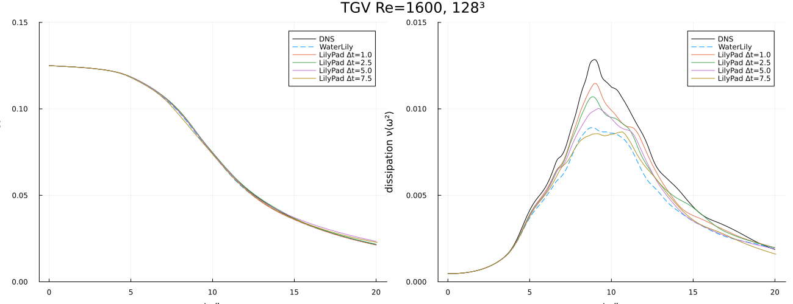

# LilyPad.jl

LilyPad.jl is a semi-Lagrangian momentum-step variant of WaterLily.jl.

The API is intentionally the same at the simulation level, so users can switch
the method by changing the constructor only.

## Method Difference

- WaterLily: uses `Simulation(...)` (flux-form convective step)
- LilyPad: uses `LilyPadSim(...)` (semi-Lagrangian advection-reflection step, fixed timestep)

Everything else (`sim_step!`, `sim_time`, field access, measurement utilities)
stays the same.

## Example: Flow Over a Circle (Same as WaterLily README)

This is the same circle setup from WaterLily's README so we can compare directly.

```julia
using WaterLily
using LilyPad

function circle_lp(n, m; Re=500, U=1)
    radius, center = m/8, m/2 - 1
    sdf(x, t) = sqrt(sum(abs2, x .- center)) - radius

    LilyPadSim((n, m),   # domain size
               (U, 0),   # domain velocity (& velocity scale)
               2radius;  # length scale
               ν=2radius*U/Re, body=AutoBody(sdf), Δt=2.5)
end

lp = circle_lp(3 * 2^6, 2^7)
sim_step!(lp, 10) # for example
```
The only difference is using the `LilyPadSim` constructor instead of `WaterLily.Simulation`.

### Comparison to WaterLily Results

The semi-Lagrangian method enables extremely large time steps without loss of stability, but this naturally changes details of the simulated solution. You can reproduce the README circle comparison locally by running:

```sh
julia --project=. examples/readme_circle_compare.jl gpu
```

Vorticity (`tU/L = 70`):


Force histories:


Outputs of `examples/readme_circle_compare.jl` (`L=64`, `Re=500`), averaged over whole lift cycles (upward zero crossings) in `t=30–60`, timed on an RTX A2000 Laptop GPU.

|                | Cd    | Cd′   | CL    | St    | s/(tU/L) |
|----------------|-------|-------|-------|-------|----------|
| WaterLily      | 1.724 | 0.130 | 1.431 | 0.258 | 0.799    |
| LilyPad Δt=2.5 | 1.741 | 0.129 | 1.422 | 0.260 | 0.090    |
| LilyPad Δt=5   | 1.766 | 0.129 | 1.438 | 0.260 | 0.051    |

LilyPad is within 2.5% of WaterLily on Cd, 1% on Cd′, CL and St, and 9× faster at `Δt=2.5`, 16× faster at `Δt=5`.

Each LilyPad step advects a half step, projects, reflects the result about the divergence-free space (Zehnder et al. 2018), then advects and projects again. Reflecting keeps the kinetic energy a projection would otherwise remove, so large steps do not over-damp vortex-sheet roll-up. Backtracks use the quadratic interpolant of the velocity, found once per cell. On the Re=1600 Taylor–Green vortex at 128³ (`examples/tgv_dissipation.jl`), the large steps follow the DNS through the roll-up:



Outputs of `examples/tgv_dissipation.jl` at 128³ (`ν` matched). WaterLily's columns are from its reference run in `examples/data/tgv`; all timings are runs to `t=20` on the same GPU.

|                | peak ν⟨ω²⟩ (t) | E(20)  | s/(tU/L) |
|----------------|----------------|--------|----------|
| DNS            | 0.0128 (9.0)   | 0.0215 |          |
| WaterLily      | 0.0089 (8.8)   | 0.0213 | 2.05     |
| LilyPad Δt=1   | 0.0115 (9.0)   | 0.0212 | 2.54     |
| LilyPad Δt=2.5 | 0.0107 (8.9)   | 0.0217 | 0.98     |
| LilyPad Δt=5   | 0.0100 (9.2)   | 0.0234 | 0.50     |
| LilyPad Δt=7.5 | 0.0087 (10.7)  | 0.0228 | 0.34     |

Up to `Δt=5` LilyPad resolves more of the dissipation peak than WaterLily on the same grid, and it is 4× faster at `Δt=5` and 6× at `Δt=7.5`.

## Quick Switching Pattern

If you already have a WaterLily setup function, make the constructor injectable:

```julia
using WaterLily
using LilyPad

function circle(make_sim, n, m; ν=0, U=1)
    radius, center = m/8, m/2 - 1
    sdf(x, t) = sqrt(sum(abs2, x .- center)) - radius
    make_sim((n, m), (U, 0), 2radius; ν, body=AutoBody(sdf))
end

wl = circle(Simulation, 96, 64)
lp = circle(LilyPadSim, 96, 64)
```

## Current Scope

This package is still under development.

- Validated in 2D and 3D on SIMD, CPU, and GPU.
- Viscous diffusion along the trajectories, stable for `νΔt ≤ 2/3` (grid units).
- No acceleration term: `g` and `udf` are not supported.
- The time-stepping defaults at `Δt = 1.5`, but an adaptive scheme that takes advantage of SL-integration stability would be better.

For method details and development notes, see `CLAUDE.md`.
