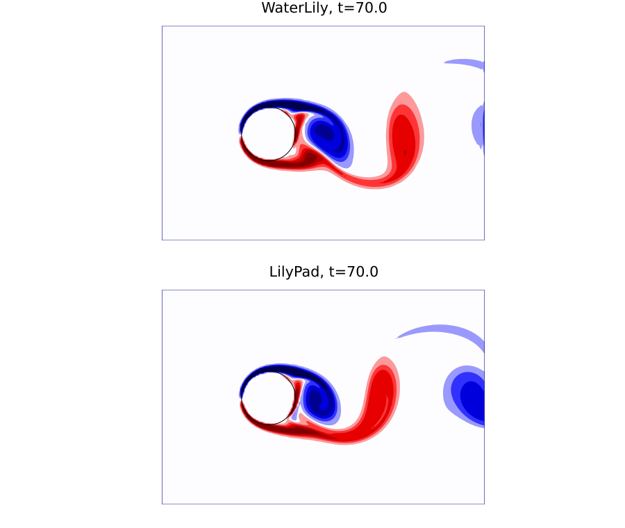

# LilyPad.jl

LilyPad.jl is a semi-Lagrangian momentum-step variant of WaterLily.jl.

The API is intentionally the same at the simulation level, so users can switch
the method by changing the constructor only.

## Method Difference

- WaterLily: uses `Simulation(...)` (flux-form convective step)
- LilyPad: uses `LilyPadSim(...)` (semi-Lagrangian BDF2 step, fixed timestep)

Everything else (`sim_step!`, `sim_time`, field access, measurement utilities)
stays the same.

## Example: Flow Over a Circle (Same as WaterLily README)

This is the same circle setup from WaterLily's README so we can compare directly.

```julia
using WaterLily
using LilyPad

function circle_lp(n, m; Re=500, U=1)
    radius, center = m/8, m/2 - 1
    sdf(x, t) = sqrt(sum(abs2, x .- center)) - radius

    LilyPadSim((n, m),   # domain size
               (U, 0),   # domain velocity (& velocity scale)
               2radius;  # length scale
               ν=2radius*U/Re, body=AutoBody(sdf), Δt=2.5)
end

lp = circle_lp(3 * 2^6, 2^7)
sim_step!(lp, 10) # for example
```
The only difference is using the `LilyPadSim` constructor instead of `WaterLily.Simulation`.

### Comparison to WaterLily Results

The semi-Lagrangian method enables extremely large time steps without loss of stability, but this naturally changes details of the simulated solution. You can reproduce the README circle comparison locally by running:

```sh
julia --project=. examples/readme_circle_compare.jl gpu
```

Vorticity (`tU/L = 70`):



Force histories:


Outputs of `examples/readme_circle_compare.jl` (`L=32`, `Re=500`, `Δt=2.5` for LP), averaged peak-to-peak over `t=30–60`, timed on an RTX A2000 Laptop GPU.

|           | Cd    | Cd′   | CL    | St    | s/(tU/L) |
|-----------|-------|-------|-------|-------|----------|
| WaterLily | 1.742 | 0.128 | 1.410 | 0.256 | 0.256    |
| LilyPad   | 1.891 | 0.141 | 1.513 | 0.256 | 0.019    |

LilyPad is ~13× faster: a 7× larger time step (WaterLily's viscous CFL gives `Δt≈0.35`) and 1.9× cheaper steps, since this small 2D case is kernel-launch bound and LilyPad launches fewer kernels.

## Quick Switching Pattern

If you already have a WaterLily setup function, make the constructor injectable:

```julia
using WaterLily
using LilyPad

function circle(make_sim, n, m; ν=0, U=1)
    radius, center = m/8, m/2 - 1
    sdf(x, t) = sqrt(sum(abs2, x .- center)) - radius
    make_sim((n, m), (U, 0), 2radius; ν, body=AutoBody(sdf))
end

wl = circle(Simulation, 96, 64)
lp = circle(LilyPadSim, 96, 64)
```

## Current Scope

This package is still under development.

- Validated in 2D and 3D on SIMD, CPU, and GPU.
- Viscous diffusion along the trajectories, stable for `νΔt ≤ 1/3` (grid units).
- No acceleration term: `g` and `udf` are not supported.
- The time-stepping defaults at `Δt = 1.5`, but an adaptive scheme that takes advantage of SL-integration stability would be better.

For method details and development notes, see `CLAUDE.md`.
